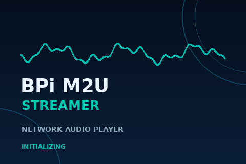

<p align="center">
  
</p>

<h1 align="center">BPi M2U Streamer</h1>

<p align="center">
  A headless network music player for the Banana Pi BPI-M2-Ultra:<br>
  Spotify Connect and a local library, out to a USB amplifier,<br>
  with a 480x320 now-playing display.
</p>

<p align="center">
  
</p>

---

## Contents

- [Features](#features)
- [Hardware](#hardware)
- [Architecture](#architecture)
- [Repository layout](#repository-layout)
- [Installation (fresh box)](#installation-fresh-box)
- [Spotify setup](#spotify-setup-one-time-per-controlling-account)
- [Local music](#local-music)
- [Display](#display)
- [Power-off](#power-off)
- [Operations cheat sheet](#operations-cheat-sheet)
- [Verified working](#verified-working)

## Features

- **Spotify Connect** device ("BPi-M2U-Streamer") via the official Spotify Soloist client. Any Premium account can control it from the normal Spotify app.
- **Local library** (mp3/flac) from `/mnt/music_library`, served by MPD and controllable from any MPD client app or `mpc`.
- **USB amp hotplug**: the audio output follows the USB amplifier when it is plugged in and falls back to onboard audio when it is not. Playback resumes on the new card without manual steps.
- **Last one started wins**: starting Spotify pauses MPD (resumed when the Spotify session ends); starting MPD pauses Spotify.
- **Now-playing display** with album art, progress, a boot splash and a bouncing-logo idle screen.
- **Self-maintaining**: Soloist builds expire after 90 days, so a weekly timer fetches the latest build.

## Hardware

| | |
|---|---|
| Board | Banana Pi BPI-M2-Ultra (Allwinner sun8i-r40, quad Cortex-A7 @ 1.2 GHz, armhf) |
| OS | [Armbian](https://www.armbian.com/boards/bananapim2ultra) 26.11 (Debian trixie), hostname `BPi-M2U-Streamer` |
| RAM / storage | 2 GB + zram swap; 7 GB eMMC |
| Audio out | USB power amplifier (ALSA card, auto-detected); test unit: SMSL USB audio |
| Music library | mounted at `/mnt/music_library` |
| Display | 480x320 ILI9486 SPI LCD on spi0 (`/dev/fb0`, 16 bpp RGB565, driver `fb_ili9486`) |
| Network | Ethernet or Wi-Fi (LAN) |

## Architecture

```
 Spotify app ──LAN──▶ Soloist ──▶ PulseAudio (system mode) ─┐
                         │                                   ├─▶ ALSA "dmixer" (dmix, 44.1 kHz) ─▶ USB amp
 MPD client ──:6600─▶ MPD ───────────────────────────────────┘        (onboard as fallback)
                         ▲
        streamer-soloist-event (polls Soloist every 2 s: pauses MPD while Spotify plays,
                                writes display state) ─▶ music-display ─▶ /dev/fb0
```

Two independent players share one ALSA card via `dmix`:

- **MPD** (Debian package) serves `/mnt/music_library`, bound to `0.0.0.0:6600`, and writes to the `dmixer` PCM directly (not through PulseAudio, which Debian's ALSA config would otherwise route `default` to).
- **Spotify Soloist** (official headless client, arm32 build from the Spotify CDN) makes the box a Spotify Connect device. It runs as user `soloist` and plays through a system-mode PulseAudio server (`streamer-pulseaudio.service`) whose single ALSA sink is the same `dmixer` PCM that MPD uses.

### Audio routing

`streamer-audio-default.sh` keeps `/etc/asound.conf` pointing at the USB sound card when present and at onboard audio otherwise. It sets the card's PCM volume to `PCM_VOLUME` percent (default 60, from `/etc/default/streamer-audio`) on activation.

udev fires one event per sound subdevice in no guaranteed order. The card event can arrive long before the driver has registered its PCM devices, and before udev fixes `/dev/snd` permissions from root:root 600 to root:audio 660. So every event recomputes the desired default from what is actually present:

- `/etc/asound.conf` is rewritten only when the result changes.
- `streamer-pulseaudio`, `mpd` and `soloist` are restarted once, after the *mpd user* can really play a few frames on the target card (a marker file in `/run` prevents repeat restarts). Players hold open audio handles, which is why the restart is needed.
- The lock is held only for the short read/write sections, never while waiting for the device, so parallel udev workers do not queue up at boot.
- A oneshot service runs the same logic in `scan` mode at boot (covers "amp already connected at power-on"). MPD is ordered after it via a drop-in so it never opens a stale default.

`dmixer` is a `dmix` soft-mixer (group-shared, `ipc_perm 0660`, so MPD and PulseAudio can both attach), so both players can hold the card open at once. Without it the second player fails with "Device or resource busy". Each card gets its own dmix `ipc_key`, so switching cards never collides with a shared-memory segment left by the previous card's players.

### Sound quality

The USB DAC (SMSL) is a USB 1.1 full-speed, adaptive device: **16-bit, 44.1 or 48 kHz only**. The path is built so the common cases are bit-transparent and everything else is converted once, with a high-quality resampler:

- dmix runs at **44.1 kHz / S16_LE**, native for CD material and Spotify. A single 44.1 kHz/16-bit stream passes through unchanged.
- Higher rates or depths (e.g. 88.2 kHz/24-bit FLAC) are converted once by MPD's `soxr` "very high" resampler and dithered to 16 bit. About 8% CPU on the A7 at 88.2 kHz.
- Spotify (44.1 kHz) reaches the same dmix with no resampling; PulseAudio uses `soxr-vhq` should a client ever differ.
- The DAC's hardware `PCM` control is a fixed reference level: the audio script sets it to `PCM_VOLUME` (60% by default) when a card is activated. MPD uses a *software* mixer (`mixer_type "software"`), set to 85%, which sounds equal in loudness to Spotify at 100%. MPD keeps the value in its state file, so on a fresh install run `mpc volume 85` once so that it can be set below Spotify, which plays at 100% and is otherwise quieter than normally mastered music; the attenuation costs less than one bit at 16 bit (MPD dithers). The DAC reports its PCM range as 0 to +16 dB, so high settings may clip digitally; keep it moderate and set loudness on the amplifier. Re-check this value when the DAC or amplifier changes.

### Spotify vs. MPD: last one started wins

`streamer-soloist-event` polls `soloist ctl now --json` every 2 s. It pauses MPD when Spotify starts playing and resumes it when Spotify's session ends. If MPD is started while Spotify plays, it pauses Spotify instead. It also persists track metadata for the display.

### Soloist updates

Soloist builds expire 90 days after their build date (exit code 10). `streamer-soloist-update.timer` re-downloads the latest arm32 build weekly, replaces `/opt/soloist` if it changed, and restarts `soloist`.

## Repository layout

| Path | Deployed to | Purpose |
|---|---|---|
| `pulse/system.pa` | `/etc/pulse/system.pa` | PulseAudio system-mode config: one ALSA sink (`soloist-sink`) on the `dmixer` PCM (44.1 kHz S16), plus a local unix socket with anonymous auth |
| `pulse/daemon.conf` | `/etc/pulse/daemon.conf` | 44.1 kHz default rate, `soxr-vhq` resampler for any client that is not 44.1 kHz |
| `systemd/streamer-pulseaudio.service` | `/etc/systemd/system/` | Runs PulseAudio in system mode (root, group audio) after the audio-default scan; restarted on card switch |
| `systemd/soloist.service` | `/etc/systemd/system/` | Runs Soloist as user `soloist`, name "BPi-M2U-Streamer", data dir `/var/lib/soloist`, 1 GB cache, initial volume 100% (brings Spotify closer to MPD in loudness), WebSocket API on 127.0.0.1:8934; clears the MPD-paused flag on start |
| `bin/streamer-soloist-event`<br>`systemd/streamer-soloist-event.service` | `/usr/local/bin/`<br>`/etc/systemd/system/` | Spotify priority (pause/resume MPD) and display state file `/var/lib/music-display/spotify.json` |
| `bin/streamer-soloist-mdns`<br>`systemd/soloist.service.d/10-mdns-lan.conf` | `/usr/local/bin/`<br>`/etc/systemd/system/soloist.service.d/` | Publishes Soloist's Spotify Connect service via avahi with the LAN addresses (Soloist itself advertises the WireGuard address, so phones could not find it for pairing); rewritten on every Soloist start |
| `bin/streamer-soloist-update.sh`<br>`systemd/streamer-soloist-update.{service,timer}` | `/usr/local/bin/`<br>`/etc/systemd/system/` | Weekly Soloist re-download from soloist-builds.spotifycdn.com |
| `default/streamer-audio` | `/etc/default/streamer-audio` | `PCM_VOLUME` (DAC volume applied on card activation, default 60) |
| `bin/streamer-audio-default.sh` | `/usr/local/bin/` | Event-driven (`add <card>` / `remove` / `scan` all do the same): recompute the default card, update `/etc/asound.conf`, restart players once the target is openable |
| `systemd/streamer-audio-default.service` | `/etc/systemd/system/` | Oneshot at boot, runs the script in `scan` mode after `sound.target` |
| `udev/99-usb-audio.rules` | `/etc/udev/rules.d/` | Runs the script on sound-card add/remove events |
| `mpd/mpd.conf` | `/etc/mpd.conf` | Music dir `/mnt/music_library`, bound to 0.0.0.0, `soxr` resampler (very high), ALSA output on `dmixer` fixed at 44100:16:2 with MPD software volume |
| `systemd/mnt-music-library.mount.d/10-rescan.conf` | `/etc/systemd/system/mnt-music-library.mount.d/` | Runs `mpc update` after every mount of the music library |
| `systemd/mpd.service.d/10-after-audio-default.conf` | `/etc/systemd/system/mpd.service.d/` | Orders MPD after the audio-default scan |
| `overlay/bpi-m2u-ili9486.dts` | `/boot/overlay-user/` (compiled to `.dtbo`) | Device tree overlay for the ILI9486 SPI panel (spi0, rotate 90, `bgr`); enabled with `user_overlays=bpi-m2u-ili9486` in `/boot/armbianEnv.txt` |
| `deploy/deploy_music_display.sh` | run on the box | Installs the now-playing display: Pillow framebuffer app, C RGB565 converter, config, systemd unit, cursor-blink drop-in. Backs up the old install and rolls back if the service does not stay up |
| `deploy/install_bootsplash.sh` | run on the box after the display is deployed | Quiet boot (serial console only), boot splash and its systemd service |
| `deploy/tag_from_folders.py` | run on the box | Tags audio files with artist/album from `<Artist>/<Album>/file` folders |
| `docs/img/` | not deployed | README images (boot splash, logo), rendered from the same drawing code the box uses |

## Installation (fresh box)

### Base image

The box runs an Armbian *community* nightly for the BPI-M2-Ultra. Nightly builds are pruned from the Armbian servers after a short time, so the exact build is pinned here:

| | |
|---|---|
| File | `Armbian_community_26.11.0-trunk.130_Bananapim2ultra_trixie_current_6.18.63_minimal.img.xz` |
| SHA-256 | `31881790f7cb1b126371c9aca8770648788eb7a044479fedb9ee6c6f917c71d9` |
| Size | 350 MB |

Where to get it:

- [Armbian board page](https://www.armbian.com/boards/bananapim2ultra) (current builds)
- [Armbian archive](https://archive.armbian.com/bananapim2ultra/) (older releases)
- [Copy of this exact file](https://github.com/planetsystemsug/bpi-m2u-streamer/releases/tag/base-image-26.11.0-trunk.130) in this repo's releases

Verify with `sha256sum`. Any later Armbian trixie image for this board should also work, but this stack has only been tested on the build above.

Run as root on the box, from a checkout of this repo.

```sh
# packages
apt-get install -y mpd mpc alsa-utils avahi-daemon python3-pil pulseaudio

# Soloist (official arm32 build; streamer-soloist-update.timer keeps it fresh)
mkdir -p /opt/soloist
curl -fsSL https://soloist-builds.spotifycdn.com/soloist_release_arm32.tar.gz \
    | tar xz -C /opt/soloist
ln -sf /opt/soloist/soloist /usr/local/bin/soloist

# soloist user + dirs (pulse-access group gives access to the system-mode socket)
useradd -r -s /usr/sbin/nologin soloist
usermod -aG audio,pulse-access soloist
mkdir -p /var/lib/soloist /var/cache/soloist \
    && chown -R soloist:audio /var/lib/soloist /var/cache/soloist

# services, udev rule, audio script, watcher + update scripts
install -m755 bin/streamer-audio-default.sh /usr/local/bin/
install -m755 bin/streamer-soloist-event /usr/local/bin/
install -m755 bin/streamer-soloist-update.sh /usr/local/bin/
install -m755 bin/streamer-soloist-mdns /usr/local/bin/
install -Dm644 systemd/soloist.service.d/10-mdns-lan.conf \
    /etc/systemd/system/soloist.service.d/10-mdns-lan.conf
install -d -o soloist -g audio /var/lib/streamer
cp pulse/system.pa pulse/daemon.conf /etc/pulse/
cp mpd/mpd.conf /etc/mpd.conf
cp default/streamer-audio /etc/default/streamer-audio
cp systemd/*.service systemd/*.timer /etc/systemd/system/
install -Dm644 systemd/mnt-music-library.mount.d/10-rescan.conf \
    /etc/systemd/system/mnt-music-library.mount.d/10-rescan.conf
install -Dm644 systemd/mpd.service.d/10-after-audio-default.conf \
    /etc/systemd/system/mpd.service.d/10-after-audio-default.conf
cp udev/99-usb-audio.rules /etc/udev/rules.d/
systemctl daemon-reload
systemctl enable --now mpd avahi-daemon streamer-audio-default \
    streamer-pulseaudio streamer-soloist-event streamer-soloist-update.timer

# music dir (must be world-readable)
mkdir -p /mnt/music_library

# display overlay (see "Display"), then reboot before the next two steps
install -d /boot/overlay-user
cp overlay/bpi-m2u-ili9486.dts /boot/overlay-user/
dtc -@ -I dts -O dtb -o /boot/overlay-user/bpi-m2u-ili9486.dtbo \
    /boot/overlay-user/bpi-m2u-ili9486.dts
grep -q '^user_overlays=' /boot/armbianEnv.txt \
    || echo 'user_overlays=bpi-m2u-ili9486' >> /boot/armbianEnv.txt

# display + boot splash (see "Display")
bash deploy/deploy_music_display.sh
bash deploy/install_bootsplash.sh
```

`soloist.service` stays disabled until an API key is stored (next section).

## Spotify setup (one-time, per controlling account)

1. Generate a Soloist API key at <https://developer.spotify.com/dashboard/soloist>. The generating account must be Premium.
2. Store it on the box and start the service:

   ```sh
   echo '<API_KEY>' | runuser -u soloist -- /usr/local/bin/soloist \
       setup-api-key -D /var/lib/soloist
   systemctl enable --now soloist
   ```

3. On a phone on the same LAN, open Spotify and pick "BPi-M2U-Streamer" in the device picker. The session is stored in `/var/lib/soloist` and restored across reboots.

To pair a different account later: stop `soloist`, run `runuser -u soloist -- /usr/local/bin/soloist -n BPi-M2U-Streamer -D /var/lib/soloist --pair`, pick the device in the app, then start the service again.

Notes:
- Only the paired account can control the device (Connect is per-account), and other accounts will not see it in their device picker.
- Spotify Free accounts see the device greyed out and cannot play to it.

## Local music

The music library is mounted at `/mnt/music_library`. Use `nofail,x-systemd.automount` in its fstab entry so a missing disk does not block boot.

The files carry no tags of their own. Artist and album come from the folder structure (`<Artist>/<Album>/track.flac`) via a tagging pass:

```sh
python3 deploy/tag_from_folders.py /mnt/music_library   # needs python3-mutagen
mpc update
```

Re-run it after copying new music into the library. Album art is picked up from `cover.jpg` in each album folder (MPD's default `album_art_names`).

When the library is mounted, systemd runs `mpc update` through the drop-in in `systemd/mnt-music-library.mount.d/`, so new music shows up without manual rescans. With `x-systemd.automount` the mount activates on first access, which MPD's periodic scan of its music dir triggers.

## Display

480x320 ILI9486 SPI panel on spi0 (`/dev/fb0`, 16 bpp RGB565).

```sh
bash deploy/deploy_music_display.sh   # app, converter, config, service
bash deploy/install_bootsplash.sh     # quiet boot + splash; reboot afterwards
```

`deploy_music_display.sh` expects a working `fb_ili9486` framebuffer at exactly 480x320 @ 16 bpp and refuses to install otherwise. It never touches the device tree, SPI, GPIO, overlays or kernel modules. If the new service does not stay active it restores the previous installation from `/var/backups/music-display-<timestamp>`.

### Panel overlay and colours

The panel is described by `overlay/bpi-m2u-ili9486.dts` (install steps above; the deploy scripts never touch it). The `bgr;` property is required: this panel is wired BGR, and without it red and blue are swapped (a pure-red frame, `0xF800` in RGB565, shows blue). The framebuffer reports standard RGB565, so the app and the C converter need no channel swap. After changing the overlay, recompile the `.dtbo` and reboot.

### What it shows

`/opt/music-display/music_display.py` (service `music-display.service`) renders now-playing info from two sources:

- **MPD**: polled over its TCP protocol (127.0.0.1:6600), including embedded album art.
- **Spotify/Soloist**: `streamer-soloist-event` writes track metadata to `/var/lib/music-display/spotify.json`, with the position interpolated and refreshed every 2 s while playing. No Spotify Web API is needed.

In `auto` mode:

1. A *playing* Spotify session wins over everything.
2. A *paused* Spotify session stays on screen until playback is stopped.
3. MPD is shown only while it is actually playing, or when there is no active Spotify session (then its paused or last-track snapshot is shown).

The watcher rewrites the state file every 30 s while a session is playing or paused, so long pauses do not age out of the display's staleness window.

### Idle screen

After `idle_clear_seconds` (default **300 s**) in a *paused or stopped* state, the display switches from the track view to an idle screen: a 96x96 circular BPi M2U logo bouncing around on a black background (the screen is not simply blanked). It animates at about 2.5 FPS (one frame every 0.4 s), moving at roughly 42 px/s horizontally and 30 px/s vertically, and reflects off the screen edges.

- The timer starts when the state becomes paused or stopped. Switching between the two does not restart it.
- Any change back to *playing* leaves the idle screen and forces a full redraw of the track view.
- Setting `idle_clear_seconds` to `0` starts the animation immediately on any pause or stop.
- Edit `/etc/music-display/config.json` and `systemctl restart music-display` to change it. Re-running `deploy_music_display.sh` keeps an existing config and only adds missing keys.

Default config:

```json
{
  "source": "auto",
  "poll_seconds": 2.0,
  "idle_clear_seconds": 300,
  "mpd": { "host": "127.0.0.1", "port": 6600, "password": "" },
  "spotify_state": "/var/lib/music-display/spotify.json"
}
```

### Performance and boot behavior

- RGB888 to RGB565 conversion runs in a small C shared library (`libfbconvert.so`, built from `rgb565.c` at install time) instead of pure Python.
- Frames are rotated 180° to match the panel mounting.
- Redraws happen only when something visible changes (position bucketed per second).
- `music-display-boot-splash.service` shows the splash (top of this page) while the box boots. `install_bootsplash.sh` also sets a serial-only console, `quiet`, `systemd.show_status=false` and `udev.log_level=0` in `/boot/armbianEnv.txt`, so nothing but the splash appears on the panel.
- A drop-in disables the console cursor blink on fbcon.

## Power-off

The box can simply be unplugged. The root filesystem is journaled ext4 (`/etc/fstab`: `commit=15`, so at most ~15 s of writes are at risk, and the journal is replayed on the next boot). `/var/log` lives in RAM (zram), so logs cost no eMMC writes. The music partition (vfat, no journal) is only written when the library database is updated or files are changed. Do not unplug during such a change. Playback and normal operation never write there.

A clean shutdown is still available: a short press of the board's power button (axp20x-pek, systemd-logind default `HandlePowerKey=poweroff`) or `sudo poweroff`.

## Operations cheat sheet

```sh
systemctl status mpd soloist streamer-pulseaudio streamer-soloist-event music-display
journalctl -fu music-display            # display logs (idle start / resume messages)
cat /etc/asound.conf                    # which card is the current default
mpc status                              # MPD state
soloist ctl now --json                  # Soloist state
```

## Verified working

As of 2026-11-20:

- MPD plays a test tone through the SMSL USB amp via ALSA (heard at 80% volume, before the default became 60%).
- udev hotplug and the boot scan set the amp card as default output. Unplugging while playing falls back to onboard; plugging in while playing switches to the amp and MPD resumes on it.
- PulseAudio system mode serves `soloist-sink` on the active card; a 440 Hz tone played through the amp as user `soloist` via `/run/pulse/native`.
- Spotify Connect end to end: paired "BPi-M2U-Streamer" from the phone app and streamed through the amp (Soloist v1.4.0.2 arm32). The update timer keeps the build fresh.
